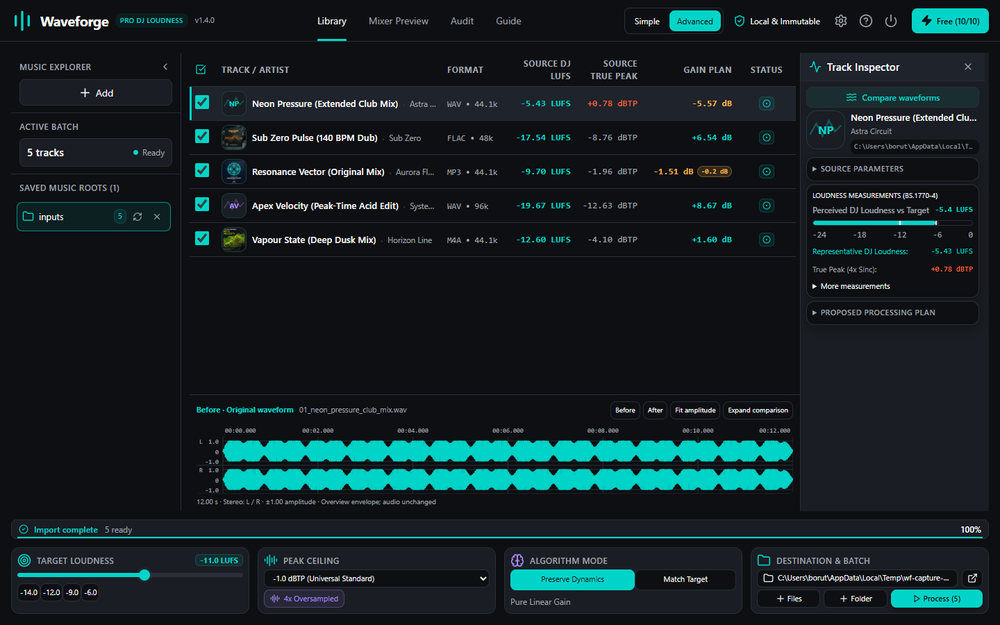
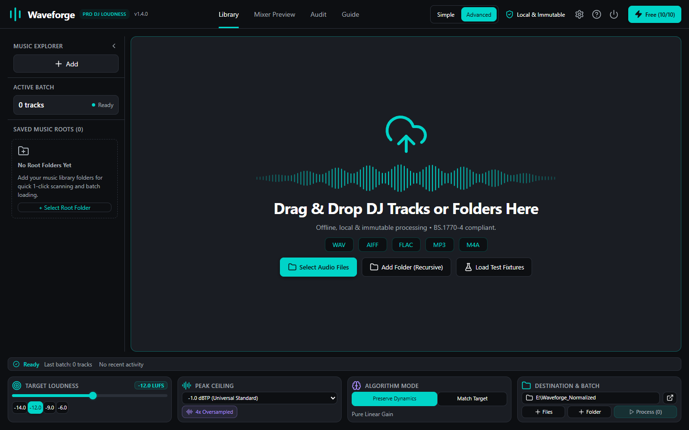
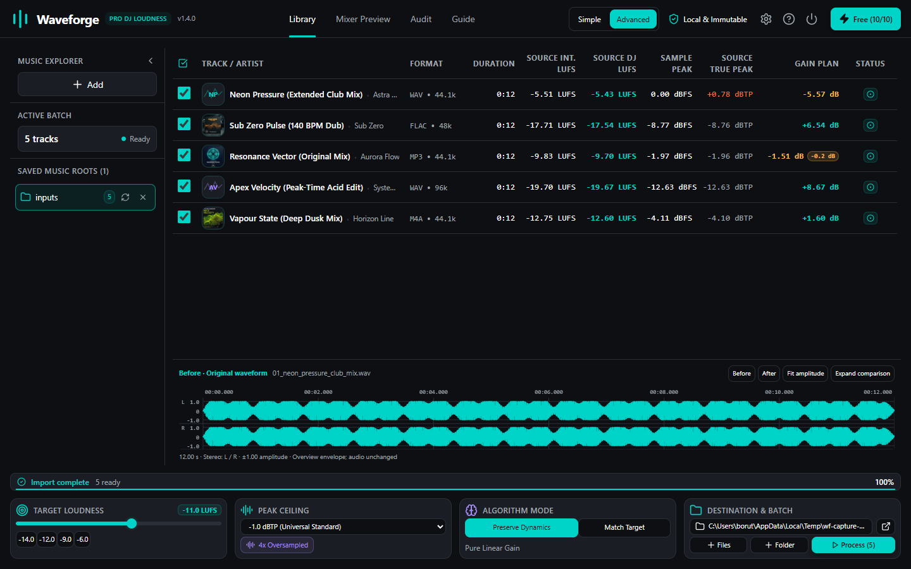
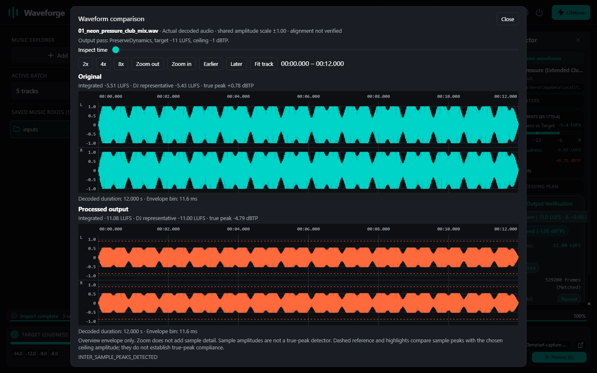
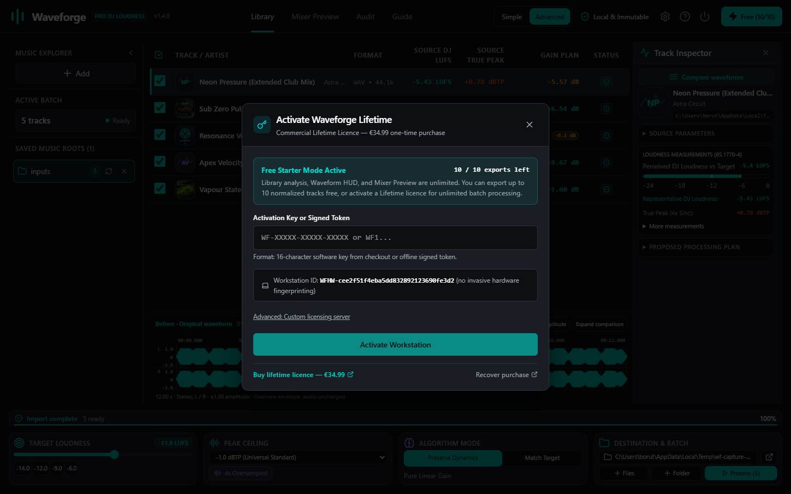
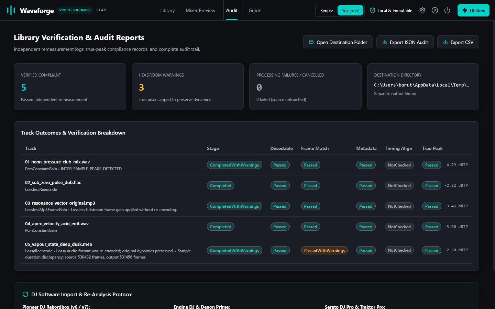
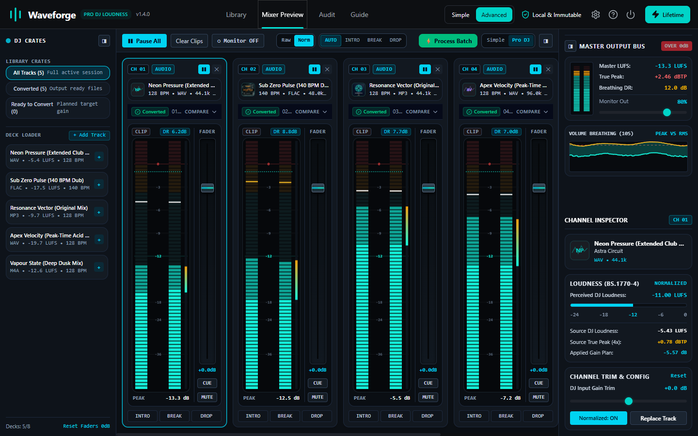

<div align="center">
  <a href="https://waveforge-app.com">
    
  </a>
  <h1 align="center">Waveforge</h1>
  <p align="center"><strong>Precision DJ Loudness &amp; 4× True-Peak Mastering Workstation for Touring DJs and Producers</strong></p>
  <p align="center"><em>100% Offline, Local-First ITU-R BS.1770-4 Normalization &amp; Lossless MP3 FrameGain with Immutable Source Protection</em></p>

  <p align="center">
    <a href="https://waveforge-app.com"></a>
    <a href="https://waveforge-app.com/tools/dj-headroom-calculator.html"></a>
    <a href="https://waveforge-app.com/tools/rekordbox-crate-checker.html"></a>
  </p>

  <p align="center">
    
    
    
    
    
  </p>

  <br />
  <a href="https://waveforge-app.com">
    
  </a>
</div>

---

## What is Waveforge?

**Waveforge** is an offline desktop audio mastering and crate loudness calibration workstation engineered for touring DJs, club residents, and electronic music producers. Built in Rust with 64-bit double-precision DSP, Waveforge removes booth volume jumps and mixer DAC clipping across mixed crates of masters from different eras and labels.

Instead of relying on software-only Auto-Gain flags that disappear when a USB stick is loaded onto standalone club hardware, Waveforge calibrates actual audio headroom against **ITU-R BS.1770-4** integrated loudness (`LUFS_int`) and **Representative DJ Drop Loudness** (`LUFS_rep`) while keeping original source files untouched.

**[Download Waveforge v1.4.0 Free Starter at waveforge-app.com](https://waveforge-app.com/#download)** · **[Try Free Online DJ Engineering Tools](https://waveforge-app.com/tools/dj-headroom-calculator.html)**

---

## Audio DSP & Safety Architecture

<div align="center">
  <p>
    
    
    
    
    
  </p>
</div>

### How Waveforge Processes Crates Safely

```text
[Local DJ Crate: WAV / AIFF / FLAC / ALAC / MP3 / M4A] (Strictly Read-Only Source)
                     │
                     ▼
┌─────────────────────────────────────────────────────────────────────────┐
│          64-BIT FLOAT LOUDNESS & INTERSAMPLE ANALYSIS ENGINE            │
│  • ITU-R BS.1770-4 K-Weighting + Dual-Stage Gating (-70 LUFS / -10 LU)  │
│  • Representative DJ Loudness (Upper Energy / Drop Focus LUFS_rep)      │
│  • 4× Oversampled Polyphase Sinc True-Peak Detection (Annex 2 dBTP)     │
└────────────────────────────────────┬────────────────────────────────────┘
                                     │
                     ┌───────────────┴───────────────┐
                     ▼                               ▼
       [Preserve Dynamics Mode]            [Match Target Mode]
       • Pure Linear Scalar Gain           • Full Target Gain Plan
       • 0% Limiting / No Compression      • 4× Lookahead Brickwall Limiter
       • Lossless MP3 global_gain (±1.5dB)   Engages Only Above Ceiling
                     │                               │
                     └───────────────┬───────────────┘
                                     ▼
┌─────────────────────────────────────────────────────────────────────────┐
│          ATOMIC STAGING & INDEPENDENT DISK VERIFICATION GATE            │
│  • Writes to Separate Output Folder via Atomic .tmp File Staging        │
│  • Preserves ID3v2, Rekordbox GEOB, Traktor NML, Vorbis & RIFF Chunks   │
│  • Reopens Every Output File from Disk to Independently Remeasure LUFS  │
└─────────────────────────────────────────────────────────────────────────┘
```

1. **ITU-R BS.1770-4 & Representative Drop Calibration**:
   - Computes both Integrated Loudness (`LUFS_int`) and drop-focused Representative DJ Loudness (`LUFS_rep`) so long atmospheric intros do not push drop levels past club headroom.
   - Includes booth presets (`-9.0 LUFS` Peak-Time, `-11.0 LUFS` Club Standard, `-12.0 LUFS` Dynamic Club, `-14.0 LUFS` Streaming) alongside continuous manual target selection.
2. **4× Oversampled True-Peak Protection**:
   - Applies ITU-R BS.1770-4 Annex 2 polyphase sinc interpolation to catch intersample overshoots before they clip Pioneer CDJ or DJM DAC stages (`-1.0 dBTP` default ceiling).
3. **Lossless MP3 FrameGain Without Re-Encoding**:
   - In `PreserveDynamics`, modifies MPEG `global_gain` bitstream fields directly in `1.505 dB` steps without decode/re-encode generational loss, retaining ID3 tags and cue chunks.
4. **Independent Physical Disk Remeasurement**:
   - Every exported file is reopened directly from storage through a fresh decoder pass to verify decodable frames, metadata retention, and post-write LUFS and `dBTP` readings.

---

## The 7-Stage DJ Mastering Workflow

```text
[1. Drop Crate] -> [2. Gain Plan] -> [3. Inspect] -> [4. Waveform HUD] -> [5. Trial / Key] -> [6. Disk Audit] -> [7. Multi-Deck Mixer]
 Read-Only Scan     LUFS vs dBTP     BS.1770-4      Original vs Out     10 Free / Ed25519    5-Gate Receipt    Raw vs Norm A/B
```

| Stage | View / Component | What It Does |
|---|---|---|
| **1. Crate Dropzone** | **Drag & Drop Ingestion** | Scans recursive folders locally for `WAV`, `AIFF`, `FLAC`, `MP3`, `ALAC`, `AAC`, and `M4A` without modifying source files. |
| **2. Batch Planning** | **Loudness & Gain Matrix** | Displays format, sample rate, `LUFS_int`, `LUFS_rep`, Sample Peak, `4×` True Peak (`dBTP`), and transparent gain / headroom shortfall. |
| **3. Track Inspector** | **Hardware AudioMeter** | Real-time BS.1770-4 metering, peak-hold notch, codec telemetry, and inline stereo waveform preview. |
| **4. Waveform HUD** | **Dual-Lane Comparison** | Synchronized Original (cyan) vs. Processed (orange) waveform lanes with `2x`/`4x`/`8x` zoom and `-1.0 dBTP` ceiling guides. |
| **5. Free Trial & Offline Activation** | **10 Free Exports / Ed25519 Unlock** | Includes 10 verified exports right out of the box, plus offline activation via `WF-...` key or signed `WF1...` token for unlimited exports. |
| **6. Audit Receipts** | **Disk Verification Gate** | Verifies Decodable frames, Frame Match, Metadata retention (`LIST`/`bext`/`cue`/`id3`), and post-write True Peak; exports JSON & CSV logs. |
| **7. Mixer Preview** | **Multi-Deck A/B Console** | Up to 8 virtual decks (`CH 01–08`), instant **Raw vs. Norm** switching, Intro/Break/Drop jumps, and 10s rolling RMS/Peak breathing scope. |

---

## Core Architecture & Guarantees

- **Local & Air-Gapped Audio Processing**: Unreleased promos, dubplates, and pre-release masters stay strictly on local storage with zero cloud uploads or telemetry.
- **Strict Source Media Immutability**: Source files are opened read-only and never mutated. Outputs write into a separate folder through atomic `.tmp` staging.
- **Lossless Bitstream & Metadata Preservation**: Supports 16/24/32-bit float `WAV` (including Broadcast WAV `bext`), `AIFF`, `FLAC`, `ALAC`, `MP3`, and `M4A` while retaining `ID3v2`, Pioneer `GEOB`, Traktor `NML`, Vorbis comments, RIFF metadata chunks, and embedded artwork.
- **Selectable Dynamics Policy**: Choose **`PreserveDynamics`** for pure linear gain (zero compression, explicit headroom shortfall reporting) or **`MatchTarget`** when uniform club targets require transparent lookahead limiting.
- **Cross-Platform Desktop Builds (`v1.4.0`)**: Native installers for **Windows 10/11 (x64)**, **macOS 12+ Universal** (Apple Silicon M1–M4 & Intel x86_64), and **Linux x64** (`AppImage` & `.deb`).

---

## Licensing & Free Tools

| Tier / Offering | Price | Availability | Key Capabilities Included |
|---|---|---|---|
| **Free Online DJ Tools** | **€0.00**<br>*(No Account)* | Web Browser<br>*(Local JS)* | [DJ Headroom & Intersample Peak Calculator](https://waveforge-app.com/tools/dj-headroom-calculator.html) · [Rekordbox, Traktor & Serato XML Crate Health Checker](https://waveforge-app.com/tools/rekordbox-crate-checker.html) |
| **Waveforge Free Starter (`v1.4.0`)** | **€0.00**<br>*(No Account)* | Windows · macOS Universal · Linux | Unlimited local library scanning, BS.1770-4 metering, Dual-Lane Waveform HUD & 8-deck Mixer Preview · **10 verified track exports** offline (cancelled/failed runs never consume credits) |
| **Waveforge Lifetime Desktop** | **€34.99**<br>*(One-Time)* | Windows · macOS Universal · Linux | Unlimited offline batch exports, `4×` True-Peak limiting & Lossless MP3 FrameGain · JSON/CSV disk verification receipts · **2 concurrent workstation activations** with self-service deactivation & key recovery · Free `v1.x` updates & **30-day money-back guarantee** |

---

## Workstation Tour (`v1.4.0` Native App Captures)

<div align="center">
  <h3>Empty Dropzone &amp; Multi-Format Ingestion</h3>
  <p><em>Drag tracks or recursive library folders locally with target loudness, true-peak ceiling, mode controls, and Free Starter export counter</em></p>
  

  <h3>Batch Loudness &amp; Transparent Gain Planning Matrix</h3>
  <p><em>Inspect Duration, Source Integrated LUFS, Representative DJ LUFS, Sample Peak, 4× True Peak (dBTP), and planned gain / shortfall chips before export</em></p>
  

  <h3>Track Inspector &amp; BS.1770-4 AudioMeter</h3>
  <p><em>Per-track loudness breakdown vs. club target, codec telemetry, and embedded artwork inspection</em></p>
  

  <h3>Dual-Lane Waveform Comparison HUD</h3>
  <p><em>Decoded Original (cyan) vs. Processed Output (orange) on a shared amplitude scale with 2x/4x/8x zoom and -1.0 dBTP ceiling guides</em></p>
  

  <h3>Free Starter Allowance &amp; Air-Gapped Ed25519 Activation</h3>
  <p><em>Shows remaining offline Free Starter exports (10/10) alongside one-time activation via 16-character key or offline token</em></p>
  

  <h3>Independent Disk Verification &amp; Audit Reports</h3>
  <p><em>Physical post-write remeasurement verifying decodable frames, preserved metadata, LosslessMp3FrameGain, and true-peak ceilings</em></p>
  

  <h3>Multi-Deck Mixer Preview (v1.4.0)</h3>
  <p><em>Audition up to 8 tracks side by side with Raw vs. Norm switching, Intro/Break/Drop section jumps, and 10s rolling Peak/RMS scope</em></p>
  
</div>

---

## Getting Started (Free 10-Track Trial -> Optional Lifetime Unlock)

1. Download the native **Waveforge `v1.4.0` Free Starter** installer for Windows, macOS Universal, or Linux from **[waveforge-app.com/#download](https://waveforge-app.com/#download)** — no account or checkout required to install and inspect libraries.
2. Drag local audio files or a recursive DJ folder (`WAV`, `AIFF`, `FLAC`, `MP3`, `M4A`) into the **Library** dropzone to inspect Integrated/Representative LUFS, 4× True Peak, and exact gain plans unlimited times.
3. Choose a loudness target (e.g. `-11.0 LUFS` Club Standard), set the `-1.0 dBTP` true-peak ceiling, select `Preserve Dynamics` or `Match Target`, and export up to **10 verified tracks** free into a separate output directory.
4. Inspect post-write measurements in **Audit** and audition Raw vs. Normalized audio in **Mixer Preview**. When you need unlimited batch exports across 2 workstations, unlock offline from the header licence badge (`€34.99` Lifetime).

---

## Who Uses Waveforge

- **Club & Festival DJs**: Balance older vinyl rips, streaming promos, and modern masters to uniform loudness before soundcheck or Rekordbox/Serato/Engine USB export.
- **Electronic Producers & Mastering Studios**: Identify `+0.5` to `+3.0 dBTP` intersample DAC reconstruction overshoots before sending promos or test masters out.
- **Radio Residents & Archive Curators**: Batch-normalize mixed-format crates with non-destructive source handling and verifiable JSON/CSV receipts.

---

## Technical Research & Official Links

- **Official Website & Free Starter Downloads**: [https://waveforge-app.com](https://waveforge-app.com)
- **Visual Step-by-Step Guide**: [https://waveforge-app.com/#guide](https://waveforge-app.com/#guide)
- **Free DJ Headroom Calculator**: [https://waveforge-app.com/tools/dj-headroom-calculator.html](https://waveforge-app.com/tools/dj-headroom-calculator.html)
- **Free Rekordbox XML Crate Checker**: [https://waveforge-app.com/tools/rekordbox-crate-checker.html](https://waveforge-app.com/tools/rekordbox-crate-checker.html)
- **Engineering Articles**:
  - [Why Digital Masters Clip on Pioneer CDJ Mixers (Intersample Peaks)](https://waveforge-app.com/articles/why-club-masters-clip-pioneer-cdj.html)
  - [ITU-R BS.1770-4 Loudness Normalization for DJs](https://waveforge-app.com/articles/itu-bs1770-true-peak-oversampling-guide.html)
  - [Lossless MP3 FrameGain vs. Lossy Re-Encoding](https://waveforge-app.com/articles/lossless-mp3-framegain-vs-reencoding.html)
- **Comparisons**:
  - [Waveforge vs. Platinum Notes](https://waveforge-app.com/compare/waveforge-vs-platinum-notes.html)
  - [Waveforge vs. MP3Gain](https://waveforge-app.com/compare/waveforge-vs-mp3gain.html)
- **Pricing & Compliance**: [Pricing Spec](https://waveforge-app.com/pricing.md) · [Open-Source Notices & SBOM](https://waveforge-app.com/opensource/)

---

<div align="center">
  <sub>© 2026 Waveforge · Documentation assets in this repository are MIT-licensed; the Waveforge desktop application offers a free 10-track starter allowance and commercial Lifetime licence (<a href="https://waveforge-app.com/opensource/">open-source notices</a>). Pioneer DJ, Rekordbox, Serato, Traktor, and Engine DJ are trademarks of their respective owners.</sub>
</div>
